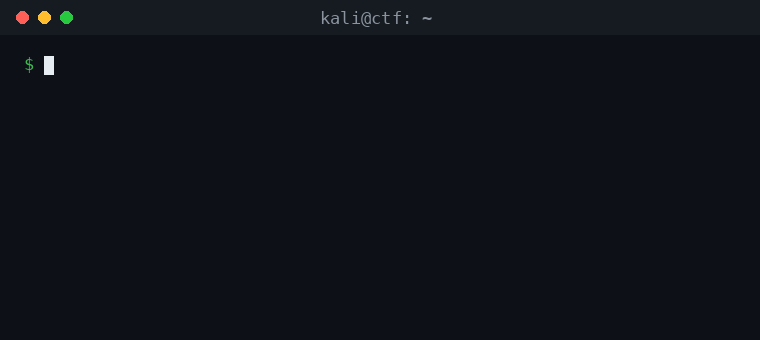
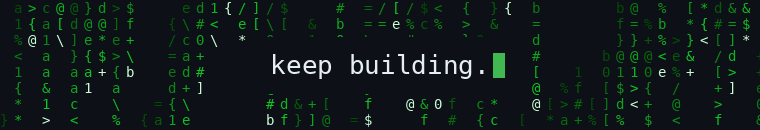

  

 

## `$ whoami`

First-year CSE student at CUET. I build web products, break into CTF boxes, and wire up small robots.
 

## `$ cat skills.txt`

- **Languages** — C · C++ · JavaScript · TypeScript · Python
- **Web** — React · Next.js · Tailwind · Node · PostgreSQL · Prisma · MongoDB
- **Embedded** — Arduino · ESP32
- **Tools** — Git · Vercel · Cloudflare

 

## `$ ./ctf --kali`

Kali Linux · Parrot OS · Nmap · web enumeration · Python scripting 
Capture The Flag competitions.

 

  

 

## `$ ls projects/`

- **ShorotApp** — e-commerce platform · Next.js, TypeScript, Prisma, PostgreSQL
- **Face Attendance** — attendance via face embeddings · Python, SQLite
- **Line Follower** — autonomous robot car · Arduino
- **Wall Socket** — remote-controlled power socket · Arduino
- **Drone** — flight stabilization, in progress · ESP32, MPU6050

 

## `$ contact`

[shajin.me](https://shajin.me) · [GitHub](https://github.com/shajinahsan) · [Email](mailto:me@shajin.me)

  
  
